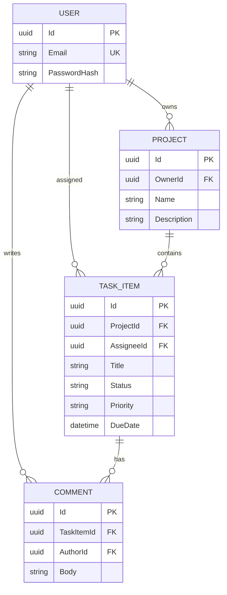

# Task Tracker API

A mini-Jira REST API built with ASP.NET Core 8. It demonstrates authenticated multi-tenant CRUD, relational modeling, workflow rules, filtered pagination, Redis caching, raw SQL reporting, validation, tests, containers, and CI.

## Features

- JWT registration/login with BCrypt password hashing
- Owner-scoped projects; task and comment access inherits the project boundary
- CRUD for projects, tasks, and comments
- Task workflow: `Todo ↔ InProgress ↔ Done` (no direct `Todo → Done`)
- Task filtering by status and assignee, sorting, and pagination
- Redis caching for project and task lists with version-based invalidation
- Parameterized raw SQL report for task counts by status
- FluentValidation plus RFC 7807-style global error responses
- Swagger UI with Bearer authentication
- 10 xUnit/Moq service-layer tests
- PostgreSQL migration, Docker Compose, and GitHub Actions CI

## Tech stack

| Area | Technology |
|---|---|
| API | C#, .NET 8, ASP.NET Core Web API |
| Data | EF Core 8, Npgsql, PostgreSQL 16 |
| Cache | Redis 7, StackExchange.Redis |
| Security | JWT Bearer, BCrypt.Net-Next |
| Validation/docs | FluentValidation, Swagger/OpenAPI |
| Tests | xUnit, Moq |
| Delivery | Docker Compose, GitHub Actions |

## Architecture

Requests flow through `Controllers → Services → Repositories → EF Core/PostgreSQL`. Controllers translate HTTP concerns. Services own authorization, workflow, cache invalidation, and mapping. Repositories own queries and persistence.



## Run with Docker (recommended)

Requirements: Docker Desktop with Compose.

```bash
git clone <repository-url>
cd "Task tracker API"
JWT_KEY="replace-with-a-long-random-secret" docker compose up --build
```

On PowerShell:

```powershell
$env:JWT_KEY = "replace-with-a-long-random-secret"
docker compose up --build
```

The API starts at `http://localhost:8080`; Swagger is at `http://localhost:8080/swagger`. Compose waits for PostgreSQL and Redis health checks and applies EF migrations on startup.

## Run locally

Requirements: .NET 8 SDK, PostgreSQL, and Redis.

1. Set `ConnectionStrings__Postgres`, `ConnectionStrings__Redis`, and `Jwt__Key`, or edit `src/TaskTracker.Api/appsettings.json`.
2. Restore the repository-local EF tool and apply migrations:

```bash
dotnet tool restore
dotnet ef database update --project src/TaskTracker.Api --startup-project src/TaskTracker.Api
```

3. Start the API and run tests:

```bash
dotnet run --project src/TaskTracker.Api
dotnet test TaskTracker.sln
```

## Endpoints

Except for registration and login, send `Authorization: Bearer <token>`.

| Method | Route | Description |
|---|---|---|
| POST | `/api/auth/register` | Register and receive a JWT |
| POST | `/api/auth/login` | Login and receive a JWT |
| GET/POST | `/api/projects` | List/create projects |
| GET/PUT/DELETE | `/api/projects/{id}` | Read/update/delete an owned project |
| GET/POST | `/api/projects/{projectId}/tasks` | List/create tasks |
| GET | `/api/projects/{projectId}/task-status-counts` | Raw SQL status-count report |
| GET/PUT/DELETE | `/api/tasks/{id}` | Read/update/delete a task |
| GET/POST | `/api/tasks/{taskId}/comments` | List/create comments |
| GET/PUT/DELETE | `/api/comments/{id}` | Read/update/delete an authored comment |

Task list example:

```text
GET /api/projects/{projectId}/tasks?status=InProgress&assigneeId={userId}&sortBy=dueDate&descending=false&page=1&pageSize=20
```

Valid sort fields are `createdAt`, `updatedAt`, `title`, `dueDate`, `priority`, and `status`. Page size is limited to 100.

## Key design decisions

- **Ownership in repository queries:** IDs are combined with the authenticated owner's ID. Returning 404 for inaccessible resources avoids confirming another tenant's data exists.
- **Service-layer rules:** authorization and task transitions live in services, keeping controllers thin and rules testable without HTTP or a database.
- **Versioned cache keys:** writes increment a small version key. Readers immediately use a new namespace without expensive Redis key scans; stale values expire naturally.
- **Resilient cache:** Redis failures are logged and treated as cache misses, leaving PostgreSQL as the source of truth.
- **Parameterized raw SQL:** the report demonstrates direct SQL safely, while its ownership join preserves tenant isolation.
- **String-backed enums:** statuses and priorities remain readable in PostgreSQL and JSON.
- **Migration opt-in:** `Database:ApplyMigrations` defaults to false for controlled releases; Compose enables it for a one-command demo.

## Verification

CI runs restore, Release build, and all tests. Locally:

```bash
dotnet build TaskTracker.sln
dotnet test TaskTracker.sln --no-build
```
